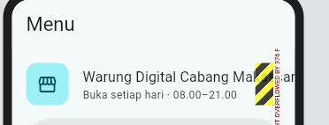
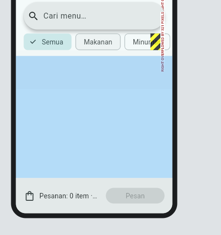
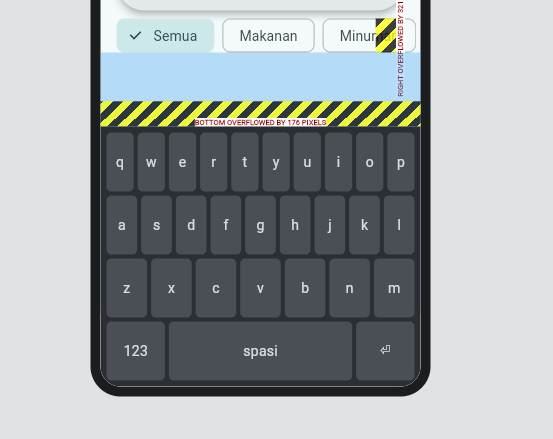

# H2 - Constraint Diagnosis

### Error 1: Right Overflow pada Teks (Teks Kepanjangan)
* **Screenshot:** 
* **Rule violated:** `Row` memberikan *unbounded width* (ruang horizontal tak terbatas) kepada anak-anaknya. Widget `Text` mencoba mengambil semua ruang untuk teks panjangnya sehingga menabrak batas maksimal layar.
* **Fix:** Membungkus widget `Text` tersebut dengan `Expanded` (agar ukurannya dibatasi oleh sisa ruang) dan menambahkan `maxLines: 2` serta `overflow: TextOverflow.ellipsis`.

### Error 2: Right Overflow pada Kategori (CategoryBar Terpotong)
* **Screenshot:** 
* **Rule violated:** `Row` menyusun kumpulan *chip* secara horizontal secara statis. Total lebar semua *chip* melebihi batas maksimal layar (*screen constraint*).
* **Fix:** Membungkus `Row` yang berisi *chip* tersebut dengan `SingleChildScrollView` dan mengatur arah scroll menjadi horizontal (`scrollDirection: Axis.horizontal`).

### Error 3: Bottom Overflow pada Layar (Tertutup Keyboard)
* **Screenshot:** 
* **Rule violated:** `Column` mencoba me-render konten statis secara vertikal melebihi tinggi layar. Saat keyboard muncul, tinggi area yang tersedia mengecil, menyebabkan konten bagian bawah menabrak batas.
* **Fix:** Mengubah struktur layout dari `Column` statis menjadi `CustomScrollView` (menggunakan *Slivers*) agar seluruh konten menjadi fleksibel dan *scrollable*.